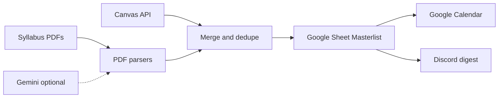

# SyllaSync

**Canvas assignments and syllabus due dates, synced to Sheets, Calendar, and Discord.**

One Windows CLI that pulls work from Canvas and syllabus PDFs, keeps a Google Sheet tracker current, mirrors due dates into Google Calendar, and can post a Discord digest of what is coming up.


[](LICENSE)

## What it does

- Pulls assignments from the Canvas API and parses syllabus / schedule PDFs (built-in parsers, with optional Google Gemini for tougher PDFs)
- Merges everything into a Google Sheet **Masterlist** tracker (columns A–H; template formulas past H are left alone)
- Upserts due dates as Google Calendar events, including a safe delete path that only removes SyllaSync-owned events after a full successful fetch
- Optionally posts a Discord webhook digest of work due in the next week
- Supports `--dry-run` to preview without writing, and `--check` to validate config without calling any service
- Treats Graded / Done / Complete / Completed as **Submitted** when assigning status, and never writes the word `Complete`

## Data flow




## Layout

- `main.py` — entry point (run from the repo root)
- `syllasync/` — application package
- `tests/` — pytest suite
- `examples/` — sample env, credentials shape, schedule and override JSON
- `scripts/` — helper utilities
- `docs/` — setup notes
- `syllabi/` — local PDF drop folder (gitignored contents)

## Quick start

Windows PowerShell, from the folder you cloned:

1. **Create a venv and install deps**

   ```powershell
   py -3 -m venv venv
   .\venv\Scripts\Activate.ps1
   python -m pip install --upgrade pip
   pip install -r requirements.txt
   ```

2. **Copy the example env and schedule files**

   ```powershell
   Copy-Item examples\.env.example .env
   Copy-Item examples\schedule.example.json schedule.json
   ```

   Edit `.env` (save as UTF-8) and replace every placeholder: `CANVAS_URL`, `CANVAS_TOKEN`, `GOOGLE_SHEET_ID`, `GOOGLE_CALENDAR_ID` and `DISCORD_WEBHOOK_URL`. `GEMINI_API_KEY` is optional. See [Credentials](#credentials) for where each value comes from. Then fill in your lecture/lab sections in `schedule.json`.

   Optional: copy `examples\due_overrides.example.json` to `due_overrides.json` and `examples\ignored_items.example.json` to `ignored_items.json` (see [Optional local JSON files](#optional-local-json-files)).

3. **Add Google credentials**  
   Download a service-account JSON key from Google Cloud and save it as `credentials.json` in the project folder (`examples\credentials.json.example` only shows the shape). Share your Sheet and Calendar with the service account `client_email` (see [Credentials](#credentials)). The Sheet needs a tab named `Masterlist`; the setup notes are in `docs\google-sheet-instructions\`.

4. **Validate config (no network calls, no secret printing)**

   ```powershell
   python main.py --check --all
   ```

   Each missing or placeholder value is listed with what to do, and the command exits with code 1 until everything `--all` needs is filled in. Plain `python main.py --check` only requires the Canvas settings. Optionally confirm Sheet access with `python scripts\test_sheets.py` (read-only).

5. **Preview, then run the full sync**

   ```powershell
   python main.py --all --dry-run
   python main.py --all
   ```

   The dry run reads from your services but writes nothing. Check its summary (rows, Calendar creates/updates/deletes) before the real run.

6. **Run it every day (optional)**

   ```powershell
   python main.py --install-schedule --time 18:00
   ```

   See [Daily run with Task Scheduler](#daily-run-with-task-scheduler).

## Docs

- Google Sheet / Masterlist setup notes: `docs/google-sheet-instructions/Assignment Tracker Instructions.pdf`

## Credentials

Placeholders only — never commit real tokens or keys.

### Canvas API token

1. In Canvas: **Account → Settings → Approved Integrations → New Access Token**.
2. Set `CANVAS_URL` to your school host (for example `https://your-university.instructure.com`).
3. Set `CANVAS_TOKEN` to the token value.

### Google Cloud (Sheets + Calendar)

SyllaSync uses a **service account** JSON key. It does not open a browser OAuth flow.

1. Create or select a project in [Google Cloud Console](https://console.cloud.google.com/).
2. Enable **Google Sheets API** and **Google Calendar API**.
3. **APIs & Services → Credentials → Create credentials → Service account**. Finish the wizard (no special project roles required).
4. Open the service account → **Keys → Add key → JSON**. Save the file as `credentials.json` in this folder.
5. Copy only the `client_email` from that JSON. Share the Sheet with that email as **Editor**, and share the Calendar with **Make changes to events**.
6. Set `GOOGLE_SHEET_ID` to the ID between `/d/` and `/edit` in the Sheet URL.
7. Set `GOOGLE_CALENDAR_ID` to the calendar owner email or the ID under **Integrate calendar** — not an iCal / `.ics` URL.

`examples/credentials.json.example` shows the expected shape with placeholders.

### Discord webhook

1. Channel settings → **Integrations → Webhooks → New Webhook**.
2. Paste the URL into `DISCORD_WEBHOOK_URL`.

### Gemini API key (optional)

1. Create a key in [Google AI Studio](https://aistudio.google.com/apikey).
2. Set `GEMINI_API_KEY` in `.env`. Leave unset to use only the built-in PDF parsers.
3. Optional: `GEMINI_MODEL` (default `gemini-3.6-flash`).

## Config reference

Values load from `.env` or `local.env` (UTF-8, BOM and CRLF accepted). `local.env` overrides `.env`.

| Variable | Required | Purpose |
| --- | --- | --- |
| `CANVAS_URL` | Yes (except `--syllabus-only`) | Canvas host URL |
| `CANVAS_TOKEN` | Yes (except `--syllabus-only`) | Canvas personal access token |
| `GOOGLE_SHEET_ID` | For `--google` / `--all` | Spreadsheet ID from the URL |
| `GOOGLE_CALENDAR_ID` | For `--calendar` / `--all` | Email or calendar ID (not iCal) |
| `DISCORD_WEBHOOK_URL` | For `--weekly` / `--all` | Discord webhook URL |
| `GEMINI_API_KEY` | No | Enables Gemini for hard-to-parse PDFs |
| `GEMINI_MODEL` | No | Defaults to `gemini-3.6-flash` |
| `ALLOWED_COURSES` | No | Comma-separated course codes; blank = all active |
| `LOCAL_TIMEZONE` | No | IANA zone; default `America/Edmonton` |
| `TERM_YEAR` | No | Four-digit year; default = current calendar year |
| `CANVAS_PAST_DUE_DAYS` | No | Past-due lookback in days; default `21` |
| `EXCEL_FILE_PATH` | No | Local workbook path; default `assignments.xlsx` |

Also keep `credentials.json` and `schedule.json` in the project folder (both gitignored when filled in).

## Optional local JSON files

These files may sit next to the project for fine-tuning what gets synced. They are gitignored when present; shapes below are examples only.

### `due_overrides.json`

Pin an exact due date/time for a specific item when Canvas or a syllabus is wrong or vague. Match by course and title (fuzzy-keyed the same way as the tracker). Optional `end` sets a calendar end time:

```json
{
  "overrides": [
    {
      "course": "PHYS 100",
      "title": "Midterm Review Quiz",
      "due": "2026-12-01 17:00",
      "end": "2026-12-01 18:00"
    },
    {
      "course": "CHEM 101",
      "title": "Lab Report 2",
      "due": "2026-11-15 23:59"
    }
  ]
}
```

Copy `examples/due_overrides.example.json` to `due_overrides.json` and edit.

### `ignored_items.json`

Hide items by Sylla Sync `task_id` (for example a Canvas id like `canvas_1001`) so they are not re-added from sources:

```json
{
  "ignored": [
    { "task_id": "canvas_1001" },
    { "task_id": "syllabus_phys_100_attendance_check_in" }
  ]
}
```

Copy `examples/ignored_items.example.json` to `ignored_items.json` and edit.

## Status handling

Sheet / Excel statuses used by the pipeline:

| Label | Meaning |
| --- | --- |
| Not Started | Default open work |
| In Progress | Started |
| Submitted | Finished (canonical write for completed work) |
| Graded | Accepted on the Sheet dropdown; kept if you typed it |
| Cancelled | Dropped / cancelled |

When the pipeline **assigns** a status, `Graded`, `Done`, `Complete`, and `Completed` all map to **Submitted**. The write path never emits the word `Complete`. If the Sheet already has a finished label at the same rank (including typed `Graded`), that cell wins over a synced value. Submitted calendar events use the title prefix `[SUBMITTED] `.

## Commands

Run from the project folder with the venv activated.

| Flag / command | Behavior |
| --- | --- |
| `python main.py --check` | Validate config; alias `--validate`. Exit 1 if required items are missing or still placeholders |
| `python main.py --check --all` | Same check, requiring Sheet, Calendar, and Discord settings |
| `python main.py --all` | Sheet + Calendar + Discord |
| `python main.py --all --dry-run` | Full pipeline preview; no writes or deletes |
| `python main.py --google` | Google Sheet only |
| `python main.py --google --calendar` | Sheet and Calendar |
| `python main.py --calendar` | Calendar only (from local Excel merge) |
| `python main.py --weekly` | Discord digest only (from local Excel merge) |
| `python main.py --course "CODE 101"` | Limit Canvas syllabus download to a matching course |
| `python main.py --skip-canvas-download` | Parse PDFs already in `syllabi/` without downloading |
| `python main.py --syllabus-only` | Skip Canvas fetch; implies `--allow-partial` |
| `python main.py --allow-partial` | Continue after a Canvas failure; Calendar deletes stay off |
| `python main.py --install-schedule [--time HH:MM] [--task-name NAME]` | Register a daily Windows Task Scheduler job that runs `--all` (default 18:00, `SyllaSync Daily`) |
| `python main.py --uninstall-schedule [--task-name NAME]` | Remove that scheduled job |
| `python main.py --daemon [--time HH:MM]` | Stay running in a terminal and run `--all` once a day |
| `python main.py` | Local Excel dashboard only |
| `python scripts/test_sheets.py` | Read-only Masterlist probe |
| `python scripts/test_sheets.py --write` | Same probe, then writes a connection marker into A1 |
| `python scripts/create_sample_syllabus.py` | Writes a sample syllabus PDF into `syllabi/` for trying the parser |
| `python -m pytest tests/ -q` | Run the test suite |

`--dry-run` may still contact services when credentials look real so the preview can show would-be creates/updates; it never mutates them, and it does not update the local `.syllasync_task_state.json`. Services whose settings are missing or still placeholders (including Canvas) are skipped with a message. `--check` never contacts them.

On a normal run, a Canvas failure stops before writes so existing rows and events stay put. With `--allow-partial`, later stages can continue from remaining data, but Calendar deletes remain disabled after a partial fetch.

## Daily run with Task Scheduler

Sylla Sync can register a daily job with Windows Task Scheduler so the full
pipeline (`main.py --all`) runs at a time you choose. Output is appended to
`logs\daily_sync.log` under the project folder.

### Install

From an activated virtual environment in the project folder:

```bat
python main.py --install-schedule --time 18:00
```

Optional flags:

- `--time HH:MM` — 24-hour clock, default `18:00`
- `--task-name "SyllaSync Daily"` — name shown in Task Scheduler

The installer creates a daily task that changes into the project directory,
runs `python main.py --all`, and appends stdout and stderr to
`logs\daily_sync.log`. Paths with spaces are quoted automatically.

### Verify

1. Open **Task Scheduler** (`taskschd.msc`).
2. Find the task named **SyllaSync Daily** (or the name you passed).
3. Confirm the trigger time and that the action points at your venv Python and
   `main.py`.

Or from a command prompt:

```bat
schtasks /Query /TN "SyllaSync Daily" /V /FO LIST
```

After a scheduled run, check `logs\daily_sync.log`.

If the generated Task Scheduler `/TR` string would exceed Windows' 261-character limit (long install paths), Sylla Sync writes a short `syllasync_daily.cmd` wrapper in the project folder and points the task at that file instead. The wrapper is gitignored.

### Uninstall

```bat
python main.py --uninstall-schedule
```

### Keep-alive alternative (`--daemon`)

If you prefer not to use Task Scheduler (or you are on another OS), leave a
terminal open with:

```bat
python main.py --daemon --time 18:00
```

The process sleeps until the next matching local time, runs the same `--all`
pipeline, logs failures, and repeats. Close the terminal (or stop the process)
to end it.

### Notes

- The default Task Scheduler registration runs in the context of the logged-on
  user. The task typically runs only while that user is signed in, unless you
  later edit the task and set a different user (`/RU`) and password options in
  Task Scheduler.
- Create or activate the project virtual environment before installing so the
  stored Python path points at the interpreter that has the dependencies.
- `--install-schedule` and `--uninstall-schedule` refuse to run on non-Windows
  systems; use `--daemon` there instead.

### Manual setup (alternative)

#### Task Scheduler GUI


1. Open **Task Scheduler** → **Create Basic Task**.
2. Name it (for example `SyllaSync daily`).
3. Trigger: **Daily**, pick a time.
4. Action: **Start a program**.
5. Program/script: full path to the venv Python, for example  
   `C:\Users\YourName\Projects\SyllaSync\venv\Scripts\python.exe`
6. Add arguments: `main.py --all`
7. Start in: the project folder, for example  
   `C:\Users\YourName\Projects\SyllaSync`
8. Finish, then open the task → **Settings** and allow run on battery / wake as you prefer.

#### Manual `schtasks` command

```powershell
schtasks /Create /TN "SyllaSync daily" /SC DAILY /ST 07:30 /TR "C:\Users\YourName\Projects\SyllaSync\venv\Scripts\python.exe main.py --all" /RL LIMITED
```

Point `/TR` at your real venv `python.exe`, and run the create command from (or ensure the task starts in) the project directory so `.env` and `credentials.json` resolve correctly. Adjust the start time as needed.

## Troubleshooting / FAQ

| Symptom | What to try |
| --- | --- |
| `UnicodeEncodeError` / cp1252 console crashes | SyllaSync switches the console to UTF-8 on startup. Keep source and `.env` as UTF-8. Prefer Windows Terminal. |
| First `.env` key ignored or odd parsing | Save `.env` as UTF-8. A UTF-8 BOM and CRLF are accepted; re-save if an older editor left a bad encoding. |
| Gemini 503 / “high demand” / quota | Wait and re-run. That PDF is skipped after retries; Canvas and other PDFs still sync. Or unset `GEMINI_API_KEY` and rely on built-in parsers. |
| Canvas 401 / token rejected | Create a new access token under Canvas Account → Settings. Confirm `CANVAS_URL` is your school host. |
| Sheets 403 / spreadsheet not found | Share the Sheet with the service account `client_email` as Editor. Confirm `GOOGLE_SHEET_ID` and that the tab is named `Masterlist`. |
| Wrong times after 1 Nov 2026 (`America/Edmonton`) | Alberta stays on UTC−6. Install current tzdata: `pip install "tzdata>=2026.5"`. Older packages still shift the zone incorrectly. |
| Calendar deletes skipped after a partial fetch | Expected. Deletes run only after a full Canvas fetch and a healthy Sheet read. Use a successful full run, or pass `--allow-partial` knowing deletes stay off. |
| `ModuleNotFoundError` | Activate `.\venv\Scripts\Activate.ps1` and `pip install -r requirements.txt`. |
| Calendar permission errors | Share the calendar as **Make changes to events**. `GOOGLE_CALENDAR_ID` must be an email or calendar ID, not an iCal link. |

## Contributing

```powershell
py -3 -m venv venv
.\venv\Scripts\Activate.ps1
pip install -r requirements.txt
python -m pytest tests/ -q
pip install ruff   # optional, lint only; not a runtime dependency
ruff check .
```

Lint config lives in `ruff.toml` (pycodestyle + pyflakes; line length not enforced). Prefer small, focused PRs with tests for status, config, and sync edge cases.

## License

Released under the [MIT License](LICENSE). Copyright (c) 2026 Akileash Saravanan.
